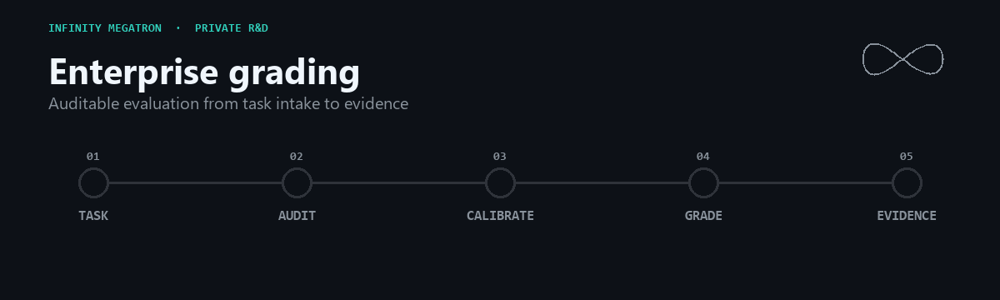

  <a href="https://numan5837-interactive.damplodge64.chatgpt.site">
  <picture>
    <source media="(prefers-reduced-motion: reduce) and (max-width: 600px)" srcset="assets/hero-v2-mobile-static.svg" />
  <source media="(prefers-reduced-motion: reduce)" srcset="assets/hero-v2-static.svg" />
  <source media="(max-width: 600px)" srcset="assets/hero-v2-mobile.svg" />
    
  </picture>
  </a>

  <a href="https://www.linkedin.com/in/numan-s-b622bb250/"><strong>LinkedIn ↗</strong></a> &nbsp; / &nbsp;
  <a href="https://github.com/search?q=is%3Apr+author%3ANuman5837&amp;type=pullrequests"><strong>Open-source contributions ↗</strong></a> &nbsp; / &nbsp;
  <a href="https://github.com/harbor-framework/terminal-bench/pulls?q=is%3Apr+author%3ANuman5837"><strong>Terminal-Bench ↗</strong></a>

  <a href="#selected-work"><picture><source media="(max-width: 600px)" srcset="assets/nav-work-mobile.svg" /></picture></a>
  <a href="#verifier-lab"><picture><source media="(max-width: 600px)" srcset="assets/nav-systems-mobile.svg" /></picture></a>
  <a href="#domain-map"><picture><source media="(max-width: 600px)" srcset="assets/nav-domains-mobile.svg" /></picture></a>
  <a href="#contribution-arcade"><picture><source media="(max-width: 600px)" srcset="assets/nav-arcade-mobile.svg" /></picture></a>

  <strong>Tbench AI · Founder &nbsp; / &nbsp; Mercor · Real World Engineer &nbsp; / &nbsp; Terminal-Bench · Domain Expert</strong> 
  Building real systems. Designing hard evaluations. Making the evidence checkable.

### Founder / Tbench AI

I’m the founder of **[Tbench AI](https://tbench.in/)**, building tools for local CI on your own compute, Jira-linked AI repair, retesting, and team approval in Slack. The focus is a reviewable path from a failing check to a retested change.

<a href="https://tbench.in/">
  <picture>
    <source media="(prefers-reduced-motion: reduce) and (max-width: 600px)" srcset="assets/founder-v2-mobile-static.svg" />
    <source media="(prefers-reduced-motion: reduce)" srcset="assets/founder-v2-static.svg" />
    <source media="(max-width: 600px)" srcset="assets/founder-v2-mobile.svg" />
    
  </picture>
</a>

 

<picture>
  <source media="(prefers-reduced-motion: reduce) and (max-width: 600px)" srcset="assets/experience-v2-mobile-static.svg" />
  <source media="(prefers-reduced-motion: reduce)" srcset="assets/experience-v2-static.svg" />
  <source media="(max-width: 600px)" srcset="assets/experience-v2-mobile.svg" />
  
</picture>

<strong>The experience behind the interface</strong>

- **Mercor · Real World Engineer:** software engineering grounded in real systems, executable workflows, and verifiable outcomes.
- **Handshake AI · Project Dynamo & Project Insight:** Terminal-Bench 2 and 3 task development across operations, mathematics, machine learning research, and data engineering.
- **Turing · Domain Expert:** scientific and mathematical Terminal-Bench tasks for Meta, connecting research-led problem selection, precise specifications, reference solutions, and reproducible verification.

I turn difficult domain problems into executable challenges, then build the environments and verifiers needed to evaluate them reliably.

 

<picture>
  <source media="(max-width: 600px)" srcset="assets/section-work-mobile.svg" />
  
</picture>

### Terminal-Bench / task engineering

Public contributions in **replica reconciliation**, **claims backlog planning**, and **stable substitution trees**. Each link opens the task, validation evidence, and review discussion. Statuses refresh automatically.

<!-- harbor-prs:start -->
**3 pull requests** · [View all on Harbor](https://github.com/harbor-framework/terminal-bench/pulls?q=is%3Apr+author%3ANuman5837)

- [#2115 · add claims\-backlog\-plan](https://github.com/harbor-framework/terminal-bench/pull/2115) · `OPEN`
- [#1985 · add stable\-substitution\-tree](https://github.com/harbor-framework/terminal-bench/pull/1985) · `OPEN`
- [#1969 · add budgeted\-replica\-reconciliation](https://github.com/harbor-framework/terminal-bench/pull/1969) · `OPEN`
<!-- harbor-prs:end -->

<strong>Case study / exact replica reconciliation under a transfer budget</strong>

An agent must recover exact record drift from compact replica sketches, choose one retry, and stay within a strict transfer budget, including cases with opposing drift across routing lanes.

| Check | Recorded evidence |
| :--- | :--- |
| [Docker validation](https://github.com/harbor-framework/terminal-bench/actions/runs/34815816471) | Passed |
| Reference oracle / no-op | `1.0` / `0.0` |
| Reported model trial set | GPT-5.6 Sol + Terminus-2 via OpenRouter: `0/5` |
| Infrastructure | All five trials completed without infrastructure errors |

In the two trajectories analyzed in detail, the agent reused one global retry multiplier: it under-sized transition cases and overspent when routes drifted in opposite directions. This is a result for that reported trial set.

[Read the task PR →](https://github.com/harbor-framework/terminal-bench/pull/1969) · [Read the failure analysis →](https://github.com/harbor-framework/terminal-bench/pull/1969#issuecomment-5661777651)

 

### Infinity Megatron / enterprise grading

`PRIVATE R&D` &nbsp; I built the enterprise grading layer for an AI-agent evaluation platform: rubric-based artifact scoring, verifier audits, Docker calibration, Pass@k trials, mutation testing, and structured evidence reports.

<picture>
  <source media="(prefers-reduced-motion: reduce) and (prefers-color-scheme: light)" srcset="assets/infinity-grading-flow-light-static.png" />
  <source media="(prefers-reduced-motion: reduce)" srcset="assets/infinity-grading-flow-dark-static.png" />
  <source media="(prefers-color-scheme: light)" srcset="assets/infinity-grading-flow-light.gif" />
  
</picture>

Private implementation · The animation presents the workflow at a high level.

### Gandalf the Grader / evaluator reliability

`OPEN-SOURCE CONTRIBUTIONS` &nbsp; Submitted patches for Windows process launching, UTF-8-safe I/O, Python 3.12 CI, malformed trajectories, and defensive handling of judge responses.

[Explore my submitted patches →](https://github.com/Handshake-AI-Research/gandalf-the-grader/pulls?q=is%3Apr+author%3ANuman5837)

 

<picture>
  <source media="(max-width: 600px)" srcset="assets/section-systems-mobile.svg" />
  
</picture>

<picture>
  <source media="(prefers-reduced-motion: reduce) and (max-width: 600px)" srcset="assets/verifier-lab-mobile-static.svg" />
  <source media="(prefers-reduced-motion: reduce)" srcset="assets/verifier-lab-static.svg" />
  <source media="(max-width: 600px)" srcset="assets/verifier-lab-mobile.svg" />
  
</picture>

**My standard:** the oracle passes; no-op and shortcut solutions fail; agent code is isolated from verifier-owned truth. A reasoning failure, a verifier defect, and an infrastructure failure each require a different diagnosis.

 

<picture>
  <source media="(max-width: 600px)" srcset="assets/section-domains-mobile.svg" />
  
</picture>

<picture>
  <source media="(max-width: 600px)" srcset="assets/domains-v2-mobile.svg" />
  
</picture>

<strong>Explore the domain map</strong>

| Domain | Task focus |
| :--- | :--- |
| **Mathematics & science** | Research-grounded problems, applied mathematics, numerical reasoning, proof and certificate verification. |
| **ML research** | Reproducible experiments, model evaluation, trajectory analysis, and evidence-based interpretation. |
| **Operations** | Planning under constraints, staffing, backlog decisions, logistics, and resource allocation. |
| **Data engineering** | Data validation, database reliability, consistency checks, and replica reconciliation. |
| **Agent infrastructure** | Terminal execution, containerized runtimes, grading pipelines, and cross-platform tooling. |
| **Verifier engineering** | Reference solutions, exact checks, oracle and no-op controls, mutation testing, and evidence reports. |

 

  

<code>Python</code> &nbsp; <code>SQL</code> &nbsp; <code>Linux</code> &nbsp; <code>Docker</code> &nbsp; <code>Exact verifiers</code> &nbsp; <code>Pass@k</code>

 

<picture>
  <source media="(max-width: 600px)" srcset="assets/section-arcade-mobile.svg" />
  
</picture>

<a href="https://numan5837-interactive.damplodge64.chatgpt.site#arcade">
<picture>
  <source media="(prefers-reduced-motion: reduce)" srcset="https://raw.githubusercontent.com/Numan5837/Numan5837/output/contribution-pacman-static.svg" />
  
</picture>
</a>

  <a href="https://numan5837-interactive.damplodge64.chatgpt.site#arcade"><strong>PLAY PAC-MAN — KEYBOARD + TOUCH ↗</strong></a> 
  This preview replays real contribution data daily. Open the website to play; GitHub’s native contribution grid below provides a static view.

 

---

  <strong>Real-world engineering. Research-grounded evaluation.</strong> 
  Difficult problems, built to be checked.  
  <a href="https://numan5837-interactive.damplodge64.chatgpt.site">INTERACTIVE PROFILE ↗</a> &nbsp; / &nbsp;
  <a href="https://tbench.in/">TBENCH AI ↗</a> &nbsp; / &nbsp;
  <a href="https://github.com/Numan5837?tab=repositories">REPOSITORIES ↗</a> &nbsp; / &nbsp;
  <a href="https://github.com/search?q=is%3Apr+author%3ANuman5837&amp;type=pullrequests">CONTRIBUTIONS ↗</a> &nbsp; / &nbsp;
  <a href="https://github.com/harbor-framework/terminal-bench/pulls?q=is%3Apr+author%3ANuman5837">TERMINAL-BENCH ↗</a>

