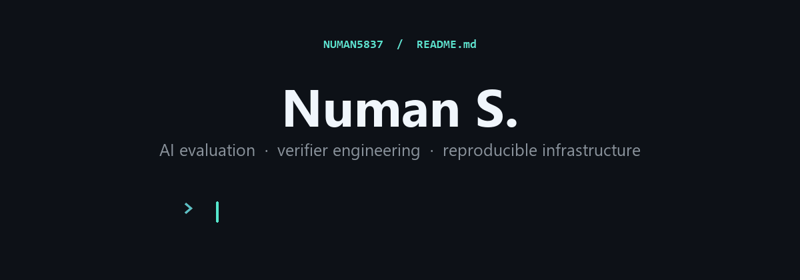
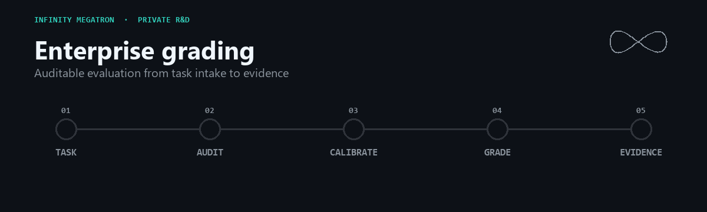

  <picture>
    <source media="(prefers-color-scheme: dark)" srcset="https://raw.githubusercontent.com/Numan5837/Numan5837/main/assets/profile-typewriter-dark.gif" />
    <source media="(prefers-color-scheme: light)" srcset="https://raw.githubusercontent.com/Numan5837/Numan5837/main/assets/profile-typewriter-light.gif" />
    
  </picture>

  I design research-grounded tasks and containerized benchmarks across mathematics, machine learning research, operations, and data engineering.

  &nbsp;
  

## 01 / AI research & benchmark experience

My work spans benchmark task development with **Handshake AI** and **Turing**, alongside verifier engineering, evaluation infrastructure, and open-source contributions.

### Handshake AI · Project Dynamo & Project Insight

I worked on **Terminal-Bench 2 through Project Dynamo** and **Terminal-Bench 3 through Project Insight**, developing tasks across **Operations, Mathematics, Machine Learning Research, and Data Engineering**. My focus is turning domain problems into executable challenges with clear instructions, reproducible environments, and outcomes that can be checked.

| Project | Benchmark | Contribution |
| --- | --- | --- |
| **Project Dynamo** | Terminal-Bench 2 | Domain-focused benchmark task development for evaluating AI agents working in terminal environments. |
| **Project Insight** | Terminal-Bench 3 | Benchmark task development across operations, mathematics, machine learning research, and data engineering. |

### Turing · Terminal-Bench tasks for Meta

I work with **Turing on Terminal-Bench tasks for Meta**, including scientific-domain and mathematical benchmark development. This work brings together research-led problem selection, precise task specifications, reference solutions, verifier design, and reproducible execution.

My scientific and mathematics work emphasizes a substantive reasoning challenge: a compact problem whose solution requires the underlying mathematics, with independently checkable results. I develop and review task packages, examine solver trajectories, and use validation evidence to distinguish reasoning failures from verifier defects or infrastructure problems.

### Domains I work in

| Domain | Task focus |
| --- | --- |
| **Scientific domains & Mathematics** | Research-grounded problems, applied mathematics, numerical reasoning, and proof or certificate-based verification. |
| **Machine Learning Research** | Reproducible research workflows, experiment analysis, model evaluation, and evidence-based interpretation of results. |
| **Operations** | Planning under constraints, staffing and backlog decisions, logistics, and resource allocation. |
| **Data Engineering** | Data processing and validation, database reliability, consistency checks, and replica reconciliation. |

Across these domains, I connect task design with reference solutions, automated grading, containerized environments, and failure analysis. The public examples below show that workflow in practice.

## 02 / From challenge to evidence

I work from a difficult agent task to the evidence needed to trust its result. The projects below follow that same path: design the challenge, build the grading system, then harden the evaluator.

> **The path:** design → calibrate → grade → analyze → harden

### Step 01 · Design the challenge

My public Terminal-Bench contributions include operational decisions and database reliability challenges with outcomes that can be checked directly. My pull requests to Harbor are listed below and refreshed automatically as their status changes.

<!-- harbor-prs:start -->
**3 pull requests** · [View all on Harbor](https://github.com/harbor-framework/terminal-bench/pulls?q=is%3Apr+author%3ANuman5837)

- [#2115 · Plan claims staffing from an incomplete backlog](https://github.com/harbor-framework/terminal-bench/pull/2115) · `OPEN`
- [#1985 · Recover coupon substitution trees from delayed fulfillment](https://github.com/harbor-framework/terminal-bench/pull/1985) · `OPEN`
- [#1969 · Reconcile drifting replicas within a transfer budget](https://github.com/harbor-framework/terminal-bench/pull/1969) · `OPEN`
<!-- harbor-prs:end -->

**A closer look at replica reconciliation.**

I designed a database reliability task that asks an agent to recover exact record drift from compressed replica sketches, choose one retry, and stay within a strict transfer budget.

**Validation:** [Docker validation passed](https://github.com/harbor-framework/terminal-bench/actions/runs/34815816471) &nbsp;·&nbsp; Oracle `1.0` &nbsp;·&nbsp; No-op `0.0` 
**Model trials:** GPT-5.6 Sol with Terminus-2 via OpenRouter &nbsp;·&nbsp; `0/5`

**[View the pull request →](https://github.com/harbor-framework/terminal-bench/pull/1969)** &nbsp;&nbsp; [Read the failure analysis](https://github.com/harbor-framework/terminal-bench/pull/1969#issuecomment-5661777651)

<strong>What the model runs showed</strong>

 

All five trials completed without infrastructure errors. In the two trajectories analyzed in detail, the agent reused one global retry multiplier. That under-sized routed transition cases and overspent when the two routes drifted in opposite directions.

*Once the challenge is calibrated, the next problem is making its grading repeatable.*

### Step 02 · Build the grading pipeline

**Infinity Megatron — enterprise grading** &nbsp;·&nbsp; `PRIVATE R&D`

I built the enterprise grading layer for **Infinity Megatron**, a private AI-agent evaluation platform. The pipeline covers rubric-based artifact scoring, verifier audits, Docker calibration, Pass@k trials, mutation testing, and structured reports.

  <picture>
    <source media="(prefers-color-scheme: dark)" srcset="https://raw.githubusercontent.com/Numan5837/Numan5837/main/assets/infinity-grading-flow-dark.gif" />
    <source media="(prefers-color-scheme: light)" srcset="https://raw.githubusercontent.com/Numan5837/Numan5837/main/assets/infinity-grading-flow-light.gif" />
    
  </picture>

Private implementation &nbsp;·&nbsp; The animation presents the workflow at a high level.

*A repeatable grading pipeline still depends on an evaluator that fails safely.*

### Step 03 · Harden the evaluator

**Gandalf the Grader — evaluator reliability** &nbsp;·&nbsp; `OPEN-SOURCE ENGINEERING`

I submitted targeted patches for cross-platform process launching, UTF-8-safe I/O, Python 3.12 CI, and safe handling of malformed trajectories and judge responses.

**[View the submitted patches →](https://github.com/Handshake-AI-Research/gandalf-the-grader/pulls?q=is%3Apr+author%3ANuman5837)**

## 03 / The evaluation loop

Across these projects, I use one repeatable process:

1. **Frame the capability.** Define the behavior being tested and the exact completion condition.
2. **Build from controlled state.** Derive expected results from data held by the verifier.
3. **Calibrate both sides.** Prove the oracle passes and shortcut or no-op solutions fail.
4. **Protect the evaluation.** Isolate agent code from fixtures, answers, and rewards.
5. **Study and harden.** Use trajectories to separate capability gaps from task defects, then improve the evaluator.

## 04 / Toolkit

| Evaluate | Reproduce | Automate |
| --- | --- | --- |
| Exact verifiers · Pass@k trials · trajectory analysis | Docker · Linux · Kubernetes · AWS | Python · Bash · PowerShell · GitHub Actions |

  

## 05 / Activity

The public part of this work continues through benchmark and evaluator pull requests.

  <picture>
    <source media="(prefers-color-scheme: dark)" srcset="https://raw.githubusercontent.com/Numan5837/Numan5837/output/github-contribution-grid-snake-dark.svg?v=activity-1" />
    <source media="(prefers-color-scheme: light)" srcset="https://raw.githubusercontent.com/Numan5837/Numan5837/output/github-contribution-grid-snake.svg?v=activity-1" />
    
  </picture>

---

  
<strong>Interested in difficult agent evaluations, exact verifiers, and the infrastructure behind trustworthy scores.</strong>

