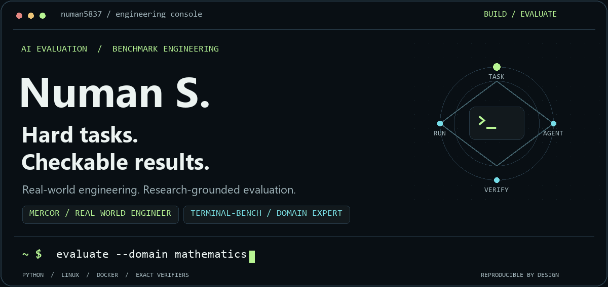
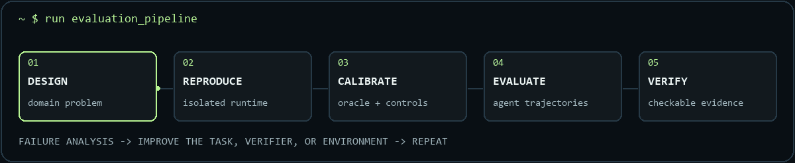

<p align="center">
  <picture>
    <source media="(prefers-reduced-motion: reduce)" srcset="assets/terminal-console-static.png" />
    
  </picture>
</p>

<p align="center">
  <strong>Mercor · Real World Engineer &nbsp; / &nbsp; Terminal-Bench · Domain Expert</strong><br />
  I turn difficult domain problems into executable tasks, exact verifiers, and reproducible evaluations.
</p>

<p align="center">
  <a href="https://www.linkedin.com/in/numan-s-b622bb250/"><strong>LinkedIn ↗</strong></a> &nbsp; · &nbsp;
  <a href="https://github.com/harbor-framework/terminal-bench/pulls?q=is%3Apr+author%3ANuman5837"><strong>Terminal-Bench work ↗</strong></a> &nbsp; · &nbsp;
  <a href="https://github.com/search?q=is%3Apr+author%3ANuman5837&type=pullrequests"><strong>Open-source contributions ↗</strong></a>
</p>

---

### `01 / whoami`

I work at the intersection of **real-world software engineering, AI-agent evaluation, and research-grounded benchmark design**. My focus is the full path from a challenging problem to evidence you can inspect: task specifications, reference solutions, containerized environments, automated grading, and failure analysis.

| Work | Focus |
| :--- | :--- |
| **Mercor**<br />Real World Engineer | Software engineering grounded in real systems, executable workflows, and verifiable outcomes. |
| **Handshake AI**<br />Project Dynamo · Project Insight | **Terminal-Bench 2 & 3** task development across operations, mathematics, ML research, and data engineering. |
| **Turing**<br />Domain Expert · Task Development | Scientific and mathematical Terminal-Bench tasks **for Meta**, with reference solutions and independently checkable results. |

### `02 / domain --expertise`

| Domain | What I build and evaluate |
| :--- | :--- |
| **Mathematics & scientific reasoning** | Research-grounded tasks, applied mathematics, numerical reasoning, proof and certificate verification. |
| **Machine learning research** | Reproducible experiments, model evaluation, trajectory analysis, and evidence-based interpretation. |
| **Operations** | Planning under constraints, staffing, backlog decisions, logistics, and resource allocation. |
| **Data engineering** | Data validation, database reliability, consistency checks, and replica reconciliation. |
| **Agent infrastructure** | Containerized runtimes, grading pipelines, verifier audits, and cross-platform tooling. |

### `03 / run evaluation_pipeline`

<picture>
  <source media="(prefers-reduced-motion: reduce)" srcset="assets/evaluation-loop-static.png" />
  
</picture>

**My evaluation standard:** the oracle passes, no-op and shortcut solutions fail, and the result can be checked independently. I distinguish model reasoning failures from verifier defects and infrastructure failures.

### `04 / ls work/selected`

#### Terminal-Bench · challenges with checkable outcomes

Public task contributions cover **replica reconciliation**, **claims backlog planning**, and **stable substitution trees**. The list below refreshes automatically from GitHub; each entry links to its review and current status.

<!-- harbor-prs:start -->
**3 pull requests** · [View all on Harbor](https://github.com/harbor-framework/terminal-bench/pulls?q=is%3Apr+author%3ANuman5837)

- [#2115 · add claims\-backlog\-plan](https://github.com/harbor-framework/terminal-bench/pull/2115) · `OPEN`
- [#1985 · add stable\-substitution\-tree](https://github.com/harbor-framework/terminal-bench/pull/1985) · `OPEN`
- [#1969 · add budgeted\-replica\-reconciliation](https://github.com/harbor-framework/terminal-bench/pull/1969) · `OPEN`
<!-- harbor-prs:end -->

<details>
<summary><strong>Inside a task: reconcile drifting replicas under a transfer budget</strong></summary>

An agent must recover exact record drift from compact replica sketches, choose one retry, and stay within a strict transfer budget. The task tests decisions near decoder capacity, including opposing drift across routing lanes.

- **Validation:** [Docker validation passed](https://github.com/harbor-framework/terminal-bench/actions/runs/34815816471); Oracle `1.0`, no-op `0.0`.
- **Reported model trial set:** GPT-5.6 Sol / Terminus-2 via OpenRouter, `0/5`, with all five trials completing without infrastructure errors.
- **Observed failure:** in the two trajectories analyzed in detail, one global retry multiplier under-sized transition cases or overspent on opposing drift.

[Read the task PR](https://github.com/harbor-framework/terminal-bench/pull/1969) · [Read the failure analysis](https://github.com/harbor-framework/terminal-bench/pull/1969#issuecomment-5661777651)

</details>

#### Infinity Megatron · enterprise grading

`PRIVATE R&D` &nbsp; I built the enterprise grading layer for an AI-agent evaluation platform: rubric-based artifact scoring, verifier audits, Docker calibration, Pass@k trials, mutation testing, and structured evidence reports.

#### Gandalf the Grader · evaluator reliability

`OPEN-SOURCE CONTRIBUTIONS` &nbsp; I submitted patches for Windows process launching, UTF-8-safe I/O, Python 3.12 CI, malformed trajectories, and defensive handling of judge responses.

[Explore my submitted patches →](https://github.com/Handshake-AI-Research/gandalf-the-grader/pulls?q=is%3Apr+author%3ANuman5837)

### `05 / cat toolkit.toml`

```toml
[engineering]
languages = [
  "Python", "Bash", "PowerShell", "SQL"
]
runtime = [
  "Linux", "Docker", "Kubernetes", "AWS"
]
automation = ["Git", "GitHub Actions"]

[evaluation]
tasks = "Terminal-Bench"
checks = "Exact verifiers + controls"
trials = "Pass@k + mutation testing"
analysis = "Trajectories + failures"
```

### `06 / git log --activity`

<picture>
  <source media="(prefers-color-scheme: dark)" srcset="https://raw.githubusercontent.com/Numan5837/Numan5837/output/github-contribution-grid-snake-dark.svg" />
  <source media="(prefers-color-scheme: light)" srcset="https://raw.githubusercontent.com/Numan5837/Numan5837/output/github-contribution-grid-snake.svg" />
  
</picture>

---

<p align="center">
  <strong>Have a hard agent task or a real-world engineering problem?</strong><br />
  Let's make the result reproducible.<br /><br />
  <a href="https://www.linkedin.com/in/numan-s-b622bb250/">Connect on LinkedIn ↗</a> &nbsp; · &nbsp;
  <a href="https://github.com/search?q=is%3Apr+author%3ANuman5837&type=pullrequests">Explore my work ↗</a>
</p>
